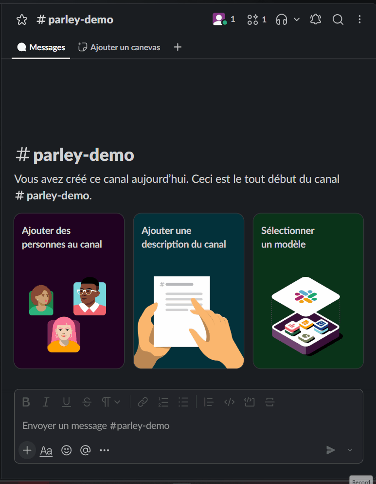

# parley

*A personal learning project exploring how to build safe, production-shaped systems that
let people query data in plain language.*

parley is a small analytics agent for New York City's yellow-taxi data. You ask it
something in plain English (or French): *"what was the average fare last January?"*,
*"which payment type tips the most?"*, *"what does RatecodeID 5 actually mean?"* It works
out whether that's a question for the data, for the documentation, or both, answers it in
the language you asked in, and shows its work.

**Try it live:** [web app](https://parley-web-chi.vercel.app/) ·
[API health](https://parley-1027854968404.europe-west1.run.app/health)

There's one rule it never breaks: **the language model doesn't write SQL.** It reads
your question and fills in a small, typed description of what you're after: a metric,
some filters, maybe a grouping. Ordinary Python turns that into the real query. The
model is a translator, not something you'd ever hand a database connection to, so the
worst it can do is misunderstand you. It can't drop a table, invent a column, or slip
something past a `WHERE` clause.

## The two pieces

- **Backend** (this repo): a FastAPI service wrapping a LangGraph agent. It classifies
  the question, builds safe SQL or retrieves docs, verifies the answer, and streams the
  result. It connects to Slack, to a web UI, or to anything that speaks HTTP.
- **Frontend**: a separate Next.js chat UI (not open-sourced yet). Pick a pseudo, ask in
  any language, watch it reason, see the SQL it ran, and browse a sidebar of past
  conversations. You can try it at the [live app](https://parley-web-chi.vercel.app/).

## Demo

Answering in Slack: it decides between the data, the docs, and a plain-English
clarification on its own, shows the SQL it ran, and tags each answer with its latency,
tokens, and cost.



## Two kinds of question: data and docs

parley answers from two very different sources, and deciding between them is the first
thing it does.

**The data path** turns a question into safe SQL over the trip records. At startup parley
scans the Parquet files and builds a catalog: which columns exist, what they are called,
how many rows there are, and which years are covered. That catalog does three jobs. It is
the whitelist the query builder checks every column against. It grounds the model so it
stops inventing years that are not in the data. And it is where the row counts come from,
read straight out of the file footers, so counting a few hundred million rows is
basically free. From there a deterministic builder assembles the SQL and DuckDB runs it.

**The docs path (RAG)** is how parley answers questions about what the data *means*
rather than what it *contains*. Taxi data is full of codes and surcharges a raw `SELECT`
can never explain: what `RatecodeID 5` is, how the congestion surcharge is defined, what
`store_and_fwd_flag` signals. The official NYC TLC data dictionaries are chunked,
embedded, and stored in a vector index (Chroma); a definitional question retrieves the
relevant passages and answers strictly from them, so the explanation is grounded in the
source documents rather than the model's memory. This retrieval path is a first-class
citizen alongside SQL, not an afterthought: it is what lets parley field "what does this
column mean?" as naturally as "what is the average of it?".

**And both at once.** When a question needs a number *and* its definition, parley runs
the SQL and the retrieval together and merges them into one answer. If a question is a
greeting or not about taxis at all, it politely says what it can actually help with
instead of guessing.

Every response carries its own cost (tokens, dollars, latency), because an LLM feature
you cannot measure is one you cannot really run. And before any answer reaches you, an
LLM-as-judge step checks it against the evidence it was built from and corrects it if it
drifts.

## Example questions

parley works the same in English and French. A sampling of what it handles, and which
path each one takes:

| English | Français | Path |
|---|---|---|
| How many trips were there in January? | Combien de courses y a-t-il eu en janvier ? | data |
| What was the average fare? | Quel est le tarif moyen ? | data |
| Which payment type tips the most? | Quel mode de paiement laisse le plus de pourboire ? | data |
| What was the longest trip distance? | Quelle a été la plus longue distance de course ? | data |
| Which pickup zones are the busiest? | Quels sont les quartiers de départ les plus fréquentés ? | data |
| What is the average trip distance by hour of day? | Quelle est la distance moyenne par heure de la journée ? | data |
| What does RatecodeID 5 mean? | Que signifie le RatecodeID 5 ? | docs (RAG) |
| How is the congestion surcharge defined? | Comment est défini le supplément congestion ? | docs (RAG) |
| What does the store_and_fwd_flag indicate? | Qu'indique le store_and_fwd_flag ? | docs (RAG) |
| What is the average fare, and what does fare_amount include? | Quel est le tarif moyen, et qu'inclut fare_amount ? | both |

## Running it

You will need [uv](https://docs.astral.sh/uv/) and a Google Gemini API key.

```bash
uv sync
export GOOGLE_API_KEY=your-key-here        # or put it in a .env file
uv run uvicorn parley.api.app:app --port 8080
```

Then ask it something:

```bash
curl -s localhost:8080/chat \
  -H 'content-type: application/json' \
  -d '{"message": "what was the average fare in January?"}'
```

Notice there is no year in that question. parley knows which years the data actually
covers, so instead of guessing it answers for the latest year it has, and hands back the
exact SQL it ran so you can check it.

## Remembering the conversation

parley is stateful when you give it somewhere to keep state. Each chat has a `thread_id`,
so follow-ups work: *"what about February?"* is rewritten into a standalone question
before it hits the router. Long threads are summarized and trimmed so context stays
bounded. And each user (identified by the pseudo they pick on the web app) gets a small
long-term memory of durable facts worth recalling next time.

All of that lives behind one seam. Set a Postgres/Neon connection (either `DATABASE_URL`
or the `POSTGRES_*` parts in `.env`) and conversations persist across restarts. Leave it
unset and it falls back to local SQLite plus in-memory, so the agent still runs with zero
setup. The tables are created automatically on first connect, with nothing to migrate by
hand.

## About the data

NYC publishes years of trip records as Parquet, and parley queries them where they live
rather than copying them around. DuckDB reads only the columns and row-groups a question
needs, so a monthly average does not drag the whole dataset off the network. The query
engine sits behind a seam, too: DuckDB handles the lake today, and the same typed-intent
layer can point at a warehouse like ClickHouse or BigQuery when the scale calls for it,
without touching how queries are built.

## A few decisions worth calling out

- **The model is treated as untrusted.** It parses questions into typed intent; it
  never emits SQL. Columns are whitelisted, values are bound parameters.
- **Business logic lives in code, not prompts.** Metrics are a small registry mapping
  names to SQL expressions, and the prompt is rendered *from* that registry, so adding a
  dataset is a registry change, not a rewrite.
- **The catalog is built once, at startup**, and grounds the whole thing in what the
  data really contains.
- **It answers in your language.** The persona and answer prompts reply in the language
  you asked in; the routing and intent prompts stay English for stable structured output.

## Tests

There is a normal unit suite, plus a small regression set: a handful of reference
questions pinned to the SQL they are expected to produce. If a prompt tweak or a model
update quietly changes the generated SQL, the regression run catches it, and reports the
latency, tokens, and cost along the way.

```bash
uv run pytest -q
```

## Status

A personal project and a work in progress. I keep iterating on it.
